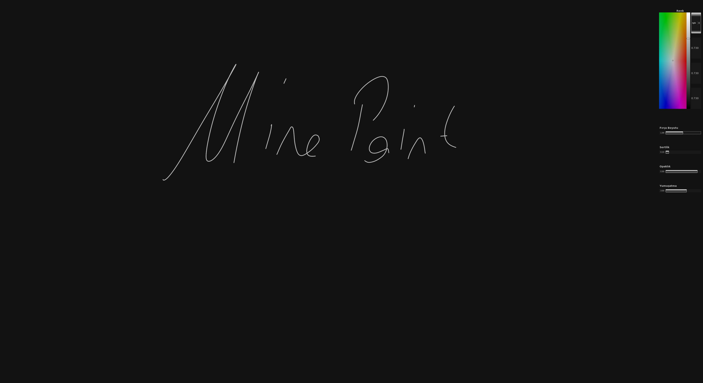

# MinePaint

A lightweight, minimal painting application and MyPaint engine clone written in **pure ATS2 (Applied Type System / Postiats)**.

MinePaint features a native ATS2 reimplementation of the MyPaint brush drawing engine, custom OpenGL hardware-accelerated canvas, and an ultra-minimal, dependency-free GUI system running directly on X11 and OpenGL.

## Features

- **Pure ATS2 Brush Engine**: Complete native ATS2 implementation of the MyPaint drawing engine (`src/draw_engine/`), including surfaces, brush dynamics, stroke dynamics, symmetry, color conversion, and brush settings metadata.
- **Hardware-Accelerated Canvas**: OpenGL tile-based rendering with $O(1)$ 2D spatial hash-table tile lookup, and smooth pan/zoom.
- **Brush Catalog**: 8 brush collections (`classic`, `deevad`, `dieterle`, `experimental`, `favorites`, `kaerhon`, `ramon`, `tanda`) grouped in the sidebar brush list (`src/brushes/`).
- **Collapsible Sidebar UI**: Top `>>` arrow collapses the sidebar to expand the drawing canvas to full screen. Hovering the cursor at the far right edge reveals a sleek floating `<<` toggle with a 1-second auto-fade timeout to restore the menu.
- **Zero Heavy GUI Dependencies**: No GTK, Qt, or FLTK required. The UI (sliders, color picker, vector stroke font rasterizer, collapsible controls) and X11 event loop are written in native ATS2 directly over X11 and OpenGL (`libX11`, `libXi`, `libGL`, `libm`).

## Demo



## Architecture

- **`src/draw_engine/`**: Pure ATS2 drawing and brush engine:
  - `brush.dats`: Brush state dynamics and dab calculation.
  - `surface_target.sats`: drawing target as a pure value (`MpTarget` = layer + `DrawMode`) and the typed `draw_dab_on` entry (no vtable, no refcount).
  - `brush_settings.dats`, `brushsettings_gen.hats`: Brush parameter and input metadata tables.
  - `minepaint_types.hats`: Core type definitions and data structures.
  - `rng.dats`: PRNG.
  - `helpers.dats`: Colour-space conversions (RGB/HSV/spectral).
  - Arena helpers: typed `arrayref` + `Ix(n)` (`src/sys/arena.hats`); no raw-pointer buffers.
- **`src/brushes/`**: Brush catalog (`catalog.dats`, `brush_group.sats`) and the 8 brush collections.
- **`src/canvas/`**: `canvas.dats` (controller), `gl_surface.dats` (OpenGL dab rendering), `layer.dats` (layers with 2D hash-table tile storage), `stroke_queue.dats` (stroke interpolation).
- **`src/ui/`**: `widgets.dats` (sliders, HSV wheel, swatches, brush list, collapsible sidebar), `font.dats` (vector font), `draw2d.dats`, `color.dats`, `palette.dats`, `state.dats`, `sidebar_state.dats`, `session.dats` (atomic palette/UI persistence).
- **`src/window/`**: `window.dats` (X11 window lifecycle), `events.dats` (event loop), `input.dats` (mouse/stylus/eraser mapping).
- **`src/x11/`, `src/gl/`, `src/sys/`**: X11/XInput2, GLX/OpenGL and libc boundary (opaque `*_box.sats` handles; C only in `src/sys/cprelude.h` and `*.cats`).
- **`src/app/ui.dats`, `src/main.dats`**: Application entry point.

## Building

### Using Nix (Recommended)

To enter the reproducible build environment:

```bash
nix-shell --pure
```

Inside the shell:

```bash
bash compile.sh -d   # Debug (use -r for Release); type-checks, builds and launches
```

### Manual Build

Prerequisites:
- [ATS2 (Postiats)](http://www.ats-lang.org/) (`patsopt`)
- CMake (>= 3.16)
- Clang (the CMake build requires `clang`; `lld` is used for Release)
- X11 development headers and libraries (`libX11`, `libXi` with `XInput2.h`, `libXfixes`)
- OpenGL development headers and library (`libGL`)

Ensure `PATSHOME` points to your ATS2 installation directory, then run `bash compile.sh -r`. The executable is `./build/minepaint`.

### Verification

Before committing, run the static type check and build gate:

```bash
bash scripts/verify.sh            # patsopt -tc on every .sats/.dats, then CMake build
bash scripts/verify.sh --no-build # type check only
```

## Effect proofs (`GL_IO`, `X_IO`, `FS_IO`, `CLOCK_IO`, `LOG_IO`)
Every effectful C boundary is declared once and borrows a linear proof: OpenGL in `src/gl/gl_io.sats` (`!GL_IO |`), X11 server calls in `src/x11/x_io.sats` (`!X_IO |`), files/environment in `src/sys/fs_io.sats` (`!FS_IO |`), clock/sleep in `src/sys/clock_io.sats` (`!CLOCK_IO |`), stderr diagnostics in `src/sys/log_io.sats` (`!LOG_IO |`). Any function that performs an effect carries the proof in its signature (IO-monad style); pure functions do not. `X_IO` is minted only by a successful `display_open` and consumed by `display_close`; `GL_IO` is minted only by a successful `glctx_create` and consumed by `glctx_destroy` (both in window.dats); `LOG_IO`/`CLOCK_IO`/`FS_IO` are process-wide and minted once in `src/sys/effect_root.dats` (`env_open`/`env_close`). Text is `Text(n)` (NUL-termination is proved by a typestate: C writers turn it into `TextRaw(n)` and only `text_seal` turns it back, so consumers like `fopen`/`sscanf` can never see an unterminated buffer); other buffers (`Buf(k, n)`: X event, window attributes, size hints; capacity is part of the type, so `fgets`/`snprintf` capacities are checked against the buffer at compile time) and the X `Display` are owned linear values borrowed with `!`; XI2 raw event data is guarded by a `RAW_LIVE` proof. `cap_mint`/`cap_burn` appear only in proof-producing source modules (R18). Time is read at the edge of the event loop and handed to the canvas as `now`. Raw memory calls (`malloc`/`free`/`memset`) exist only in `src/sys/libc.dats` (`heap_new`, `heap_free`, `bytes_zero`). Proofs are erased at compile time (no runtime cost); `scripts/check_rules.py` R9–R11 enforce where declarations may live; R13 forbids borrowed-view types, R15–R17 forbid wildcard arms, algorithmic C and functions over 20 lines, R18 confines proof minting.
